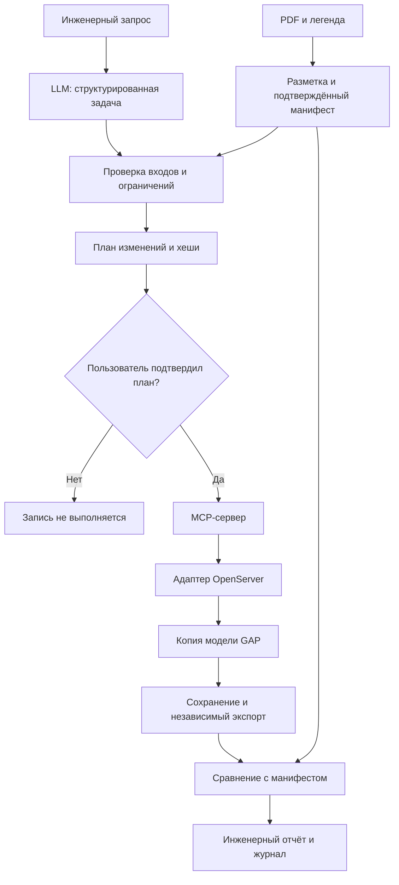

# GAP Agents — модель системы сбора по технологической схеме

Учебный проект НИР 3: разработка агента, который связывает инженерный запрос,
исходную технологическую схему и модель сети в Petroleum Experts GAP.
Система должна перенести согласованный фрагмент схемы в инженерное ПО,
прочитать сохранённую модель обратно и показать, насколько результат соответствует исходным данным.

Проект объединяет три части: инженерный манифест и проверку, интеграцию
MCP/OpenServer и LLM-агента с пользовательским сценарием.

> **Статус:** программные компоненты реализованы и проверяются автоматическими тестами.
> Инженерная приёмка фрагмента, успешный производственный перенос в GAP и сквозной
> запуск с настоящей LLM пока не подтверждены. Ниже отдельно описаны полученные
> результаты и условия, необходимые для завершения проекта.

## 1. Поставленная задача

Исходный материал — технологическая схема системы сбора Пальяновского месторождения:
`Тех.схема НСС, НН Пальяновского мр 2025.pdf` и сопровождающая её легенда.
Из неё выбирается ограниченный связный фрагмент, который должен содержать:

| Элемент | Минимальный объём |
|---|---:|
| Узлы | 10 |
| Трубы или ветви | 12 |
| Кустовые источники | 2 |
| Клапаны | 4 |

Дополнительно нужны открытый и закрытый клапаны, неоднозначное пересечение линий
и деталировка узла. Состав фрагмента и трактовку обозначений подтверждает преподаватель
или ответственный инженер.

Основная сложность — восстановить смысл схемы. Пересечение линий не всегда означает
соединение; деталировка может повторно показывать уже существующий объект;
обозначение арматуры нельзя разбирать как размеры трубы. Закрытый клапан остаётся
частью физической сети, хотя перекрывает соответствующий путь протока.

**Целевой результат:** подтверждённый манифест, размеченная схема, воспроизводимо
созданная модель GAP, независимый экспорт её объектов и инженерный отчёт о расхождениях.

### Границы расчётной задачи

Базовый этап проверяет топологию и параметры переноса. Гидравлический расчёт —
отдельное расширение: для него необходимы граничные давления/расходы, состав и PVT
флюида, температуры, высоты, шероховатость и настройки модели. Эти данные нельзя
восстановить по одной картинке сети. Подтверждённые дебиты и гидравлическая точность
не входят в текущие полученные результаты.

## 2. Способ решения

В основе решения — **подтверждаемый манифест и обратная проверка сохранённой модели**.
LLM разбирает пользовательское намерение, а инженерные значения, соединения и команды
API проходят через структурированные данные и проверяемый код.

Рабочий процесс состоит из следующих этапов:

1. **Разметка исходника.** Определяются границы фрагмента, узлы, ветви, арматура,
   источники и спорные участки. Сохраняются исходные подписи и области PDF.
2. **Подготовка манифеста.** Объектам назначаются устойчивые ID; записываются связи,
   параметры, единицы, происхождение значений и статусы инженерного подтверждения.
3. **Инженерная проверка.** Проверяются ссылки, уникальность ID, концы труб,
   геометрия и связность. Неизвестные значения остаются `null`/`unknown`.
4. **Разбор запроса.** LLM возвращает типизированную задачу: разрешённую операцию,
   выбранный случай и входные файлы. Свободные команды OpenServer не принимаются.
5. **Подготовка плана.** Для изменения модели фиксируются конкретные действия,
   целевая копия и SHA-256 входов. Пользователь подтверждает именно этот план.
6. **Выполнение через MCP.** Адаптер формирует команды установленной версии
   OpenServer, работает с отдельной моделью и сохраняет фактические ответы API.
7. **Обратное чтение.** Из сохранённой модели считываются объекты и параметры.
   Копирование входного манифеста в файл экспорта не считается обратным чтением.
8. **Сравнение и отчёт.** Экспорт сопоставляется с манифестом; выводятся пропуски,
   лишние объекты, неверные связи, различия параметров и ограничения проверки.

Операции чтения и формирования отчёта выполняются без изменения модели GAP.
Для операций записи обязательны план и отдельное подтверждение.

### Архитектура сценария записи



## 3. Реализация и распределение работы

| Часть | Ответственность | Основные компоненты |
|---|---|---|
| Участник 1 | Исходная схема, манифест, инженерная проверка и отчёт | `gap_manifest`, таблицы объектов, разметка, сравнение экспорта |
| Участник 2 | MCP, OpenServer, выполнение и обратное чтение модели | `gap_integration`, COM-worker, планы, подтверждения, журнал |
| Участник 3 | Настоящая LLM, пользовательский сценарий и общая сборка | `gap_agent`, консоль, `AgentTask`, `AgentResult`, общий `trace_id` |

### Инженерные данные

Манифест хранит ID и исходные подписи, типы объектов, физические соединения,
геометрию в заданных единицах, состояния арматуры, ссылки на источник и подтверждения.
SHA-256 позволяет обнаружить изменение исходных файлов. Ручное подтверждение
должно иметь автора и время; генерация отчёта не подтверждает данные автоматически.

Проверяются три представления связности: физическая топология, гарантированные
и возможные пути при известных/неизвестных состояниях линий и клапанов.
Это проверка достижимости, а не расчёт направления потока или гидравлики.

### Интеграция GAP

COM-worker изолирован от клиента. Технический сценарий создаёт два `JOINT` и
соединение, сохраняет модель, открывает её и проверяет повтор без дубликатов.
Учитывается, что `LINKITEMS` может самостоятельно создавать `PIPE`.

Производственный компилятор поддерживает согласованное отображение узлов,
источников, границ и ветвей. Реализованный профиль допускает **один физический
клапан на ветвь** через отдельно утверждённое отключение ветви. Подписи, DN,
рейтинг и физическое состояние сохраняются как явно обозначенные метаданные
`COMMENT`, согласованные с прочитанным `ISMASKED`; это не native-объект `VALVE`.
Длины и диаметры читаются из native-полей GAP. Для OD/толщины нужен испытанный
шаблон Enthalpy Balance и подтверждённые единицы/индексы секций.

Без подтверждённого манифеста, профиля, шаблона и реального протокола проверки
профиля производственная запись блокируется. Подробнее:
[производственный профиль](docs/production_profile.md).

### LLM и пользовательский сценарий

Клиент использует OpenAI-совместимый Chat Completions API. В текущей конфигурации
заданы Groq, модель `openai/gpt-oss-20b` и формат `json_schema`; доступность модели
и успешный ответ проверяются отдельным живым запуском.

LLM возвращает намерение и пути файлов, но не инженерные параметры, команды API
или подтверждение пользователя. Консоль показывает действия и хеш плана.
Доступные операции: `inspect`, `validate`, `report`, `compare`, `build`, `smoke`, `export`.
Неподдерживаемые запросы и неоднозначности возвращаются отдельными статусами.

## 4. Контроль выполнения и оценка результата

Общие форматы описаны в [контрактах агента](docs/agent_contracts.md),
[контрактах манифеста/экспорта](docs/contracts.md) и каталоге `schemas`.

| Механизм | Назначение |
|---|---|
| Неизменяемый план и SHA-256 | Обнаружение изменений после подготовки или подтверждения |
| Локальный receipt | Разрешение на конкретный план; LLM не имеет инструмента самоподтверждения |
| SQLite ledger | Исключение параллельного исполнения и повторной записи одного задания |
| Отдельные `run_id` / `trace_id` | Связь запроса, MCP-вызовов, native-ответов и отчёта |
| Состояние неопределённого исхода | Запрет автоповтора до ручной проверки worker/GAP и результатов |
| Проверка единиц и диапазонов | Отказ от неверных или неопределённых чисел до зависимых действий |

Состояние выполнения и инженерная оценка различаются:

- `SUCCESS` — операция выполнилась; это не подтверждение правильности физической модели.
- `OK` / `OUT_OF_TOLERANCE` — результат сравнения по утверждённым критериям.
- `NOT_ASSESSED` — подтверждённая оценка невозможна, например отсутствуют допуски или реальный экспорт.
- `NOT_READY`, `CONFIRMATION_REQUIRED`, `LLM_NOT_CONFIGURED`, `UNSUPPORTED_MAPPING`
  и статусы API/лицензии объясняют причину остановки сценария.

ID, связи и физические состояния сравниваются точно. Для числовых параметров
нужны отдельно утверждённые допуски; значения не назначаются ради получения `OK`.
Таймаут не означает отмену GAP. Инструкции в исходных документах рассматриваются
как данные и не расширяют полномочия агента.

## 5. Полученные результаты

### Подготовленные инженерные материалы

Кандидат — верхняя часть деталировки УДР с привязкой к основному виду схемы.

| Показатель текущего манифеста | Значение |
|---|---:|
| Узлы и порты | 21: 10 внутренних узлов, 2 источника, 9 границ |
| Внутренние ветви | 20 |
| Клапаны | 11: 8 открытых, 3 закрытых |
| Подтверждённые объекты | 0 из 52 |
| Открытые инженерные вопросы | 8 |
| Неизвестные параметры труб | 80: длина, OD, стенка и ID для 20 ветвей |
| Физически связные компоненты | 1 |
| Готовность к переносу | `ready_for_transfer=false` |

Дополнительно подготовлен каталог **20 наблюдений внешних трасс**. Он не является
дополнительным графом: его длины не присваиваются внутренним соединителям УДР.
Таблицы узлов, труб, клапанов, источников, границ и неоднозначностей формируются
в CSV; отчёт объединяет данные, области схемы и замечания.

Подсчёт внутренних точек как учебных узлов требует согласования преподавателя.
Нужно разрешить вопросы привязки деталировки, пересечения Р-543, разрыва №6—17,
границ фрагмента, геометрии, рабочих состояний линий и состояний арматуры.

Исходные PDF/легенда не входят в репозиторий. В чистой копии без этих двух файлов
проверка дополнительно возвращает `SOURCE_UNAVAILABLE`. Это ограничение входного
комплекта; форматная проверка кандидата не заменяет сверку с оригиналом.

### Результаты программной части

Реализованы манифест и сравнение, отчётность, MCP-сервер с шестью инструментами,
планы/подтверждения, COM-worker, компилятор, нормализатор, LLM-клиент и консоль.
Автоматические проверки включают настоящий локальный обмен по MCP stdio.

В исторической проверке OpenServer COM был доступен, но `GAP.START()` вернул
native error 22: `No OpenServer license available`. Успешный цикл создания,
сохранения и чтения модели GAP этим запуском не подтверждён. Для воспроизведения
нужны установленное инженерное ПО и действующая лицензия OpenServer.

Живой LLM-прогон с ключом API, подтверждённый производственный экспорт и инженерная
приёмка пока не представлены. Наличие адаптера и успешных unit-тестов не заменяет
эти проверки.

## 6. Тесты и проверка результатов

Контрольный прогон **23.11.2026**, код версии `5428966`, Windows / Python 3.13.5:

```text
Ran 177 tests
OK (skipped=1)
```

**176 тестов прошли, один пропущен, ошибок и падений нет.** Пропущена проверка
выхода через символическую ссылку: учётной записи Windows недоступно создание symlink.

| Группа | Что проверяется |
|---|---|
| Исходники и граф | SHA-256, ссылки на области, дубли ID, отсутствующие концы, геометрия, состояния и связность |
| Сравнение и отчёт | Пропуски/лишние объекты, ошибочные связи, числовые допуски, `null`, раздельные статусы и HTML |
| MCP и адаптер | Шесть инструментов, схемы аргументов, реальный stdio, implicit PIPE и повтор без дублей |
| Подтверждения и хранение | Хеш плана, изменения входов, повтор после перезапуска, конкуренция и блокировка неопределённой записи |
| Ошибки и восстановление | Отсутствие лицензии, таймауты, ошибки API, ручной разбор, гонки состояний и отсутствие автоповтора |
| LLM-клиент | Отключённая модель, неверные настройки/ответы API, ограничения задачи и внедрённые инструкции |
| Производственный профиль | Проверка доказательств, native TYPE/LABEL, единиц, состояния арматуры и независимости экспорта |

Большинство тестов использует явно искусственные данные и внедряемые клиенты.
Они подтверждают логику программы. MCP-проверки подтверждают реальный локальный
протокол, но не вызывают инженерный расчёт. Живые LLM и GAP проверяются отдельно.

Команды воспроизведения:

```powershell
# Полный набор автоматических тестов
.venv\Scripts\python.exe -B -X utf8 -m unittest discover -s tests -v

# Тесты, диагностика и отдельная проверка настоящего MCP stdio
.venv\Scripts\python.exe -B -X utf8 scripts/verify_project.py

# Живой LLM: 9 запросов, включая парафразы, плюс проверка отключённой модели
.venv\Scripts\python.exe -B -X utf8 scripts/evaluate_llm.py
```

`verify_project.py` без дополнительных флагов не запускает GAP и не вызывает LLM.
Его локальные результаты находятся в `outputs/verification`. Без доступа к API
живой LLM-тест остаётся неоценённым, покрытие не объявляется успешным.

## 7. Подготовка и запуск

Все примеры ниже — PowerShell из корня репозитория. Нужен Python 3.11+;
для интеграции — Windows, pywin32, установленный GAP/OpenServer соответствующей
версии и лицензия. Разрабатываемый профиль рассчитан на IPM 7.5 Build 600 / GAP 8.5.

```powershell
py -m venv .venv
.venv\Scripts\python.exe -m pip install -r requirements-integration.lock.txt
.venv\Scripts\python.exe -B -X utf8 -m gap_agent doctor
```

Также доступны `setup.ps1` и `run-agent.ps1`. Окружение `.venv` создаётся локально,
его не следует переносить с другого компьютера.

### Исходная схема

```powershell
.venv\Scripts\python.exe -B -X utf8 scripts/connect_sources.py --scheme 'ПУТЬ_К_СХЕМЕ.pdf' --legend 'ПУТЬ_К_README.txt'
.venv\Scripts\python.exe -B -X utf8 scripts/review_packet.py
```

Подключение допускается при совпадении исходных SHA-256. Другая редакция схемы
требует отдельной проверки. Пакет для согласования появится в `outputs/review_packet`.
Порядок фиксации решений: [руководство проверки](docs/review_guide.md).
Для извлечения/рендера PDF дополнительно нужны зависимости группы `pdf` из
`pyproject.toml` и Poppler для команды рендера.

### LLM и пользовательский интерфейс

Настройки находятся в `data/agent_config.json`. Ключ задаётся локально,
доступную модель при необходимости можно изменить через `GAP_LLM_MODEL`.

```powershell
$env:GROQ_API_KEY = [System.Net.NetworkCredential]::new('', (Read-Host 'Ключ Groq' -AsSecureString)).Password
.venv\Scripts\python.exe -B -X utf8 -m gap_agent chat
```

Для другого совместимого API задаются `GAP_LLM_BASE_URL` и имя переменной ключа
в конфигурации. Пример запроса: «Проверь исходный манифест и его связность».
План записи пользователь подтверждает показанной фразой и своим именем.

### Технический пример GAP

После получения доступа к ПО и лицензии:

```powershell
.venv\Scripts\python.exe -B -X utf8 -m gap_agent request 'Подготовь технический пример: два узла и одна труба'
.venv\Scripts\python.exe -B -X utf8 -m gap_agent approve --run-id RUN_ID --operator 'ИМЯ' --sha256 ХЕШ_ПЛАНА
.venv\Scripts\python.exe -B -X utf8 -m gap_agent execute --run-id RUN_ID
```

`RUN_ID` и хеш берутся из фактического ответа. Повтор `execute` возвращает
сохранённый результат. Для ручного разбора неопределённого исхода предусмотрена
локальная команда `acknowledge`; она не отменяет GAP и не повторяет прежнюю запись.
Демонстрационный сценарий: [docs/demo.md](docs/demo.md).

## 8. Путь к завершению проекта

1. Подключить оригиналы схемы и легенды, подтвердить состав учебного фрагмента.
2. Закрыть инженерные вопросы, заполнить недостающие параметры и рабочие состояния.
3. Восстановить доступ к GAP/OpenServer и выполнить успешный технический round-trip.
4. Испытать и утвердить производственный профиль, шаблон, единицы и представление клапанов.
5. Выполнить отдельный живой LLM-прогон, затем сквозной перенос подтверждённого фрагмента.
6. Считать сохранённую модель, выполнить сравнение по утверждённым допускам
   и подтвердить результат повторным запуском без дубликатов.

## 9. Структура репозитория

| Каталог | Содержимое |
|---|---|
| `gap_manifest` | Источники, валидация, таблицы, сравнение и HTML-отчёт |
| `gap_integration` | MCP, OpenServer, планы/SQLite, компилятор и нормализатор |
| `gap_agent` | LLM, задача агента, MCP-клиент, консоль и `AgentResult` |
| `data` | Манифест-кандидат, каталог трасс и конфигурационные заготовки |
| `schemas` | JSON Schema общих форматов |
| `tests` | Автоматические проверки компонентов и сценариев |
| `scripts` | Подготовка данных, отчёты, диагностика и воспроизведение проверок |
| `docs` | Контракты, инженерные пояснения, ограничения и демонстрация |

Каталоги `outputs`, `work` и `.venv` создаются локально и исключены из Git.
API-ключи, лицензии, исходные производственные документы и модели не публикуются.
